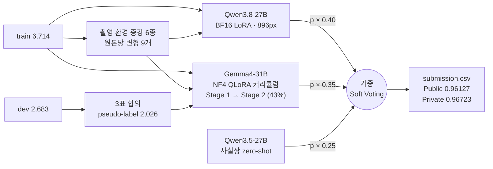
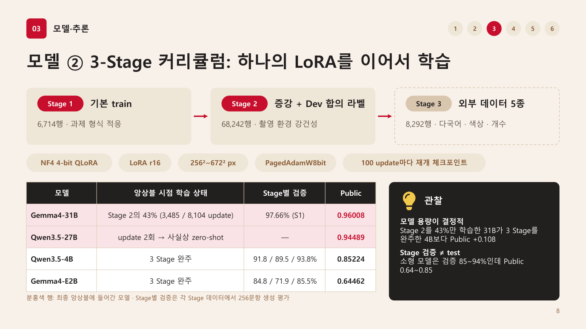
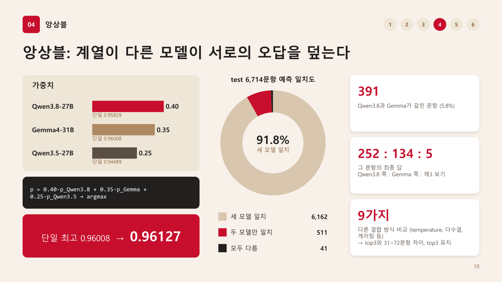
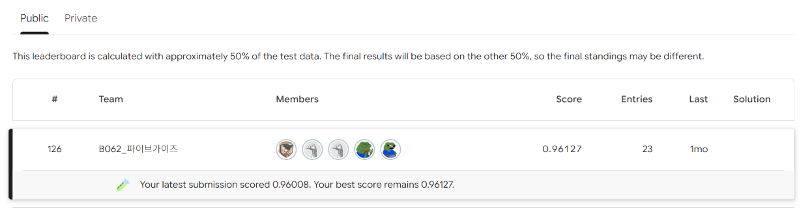
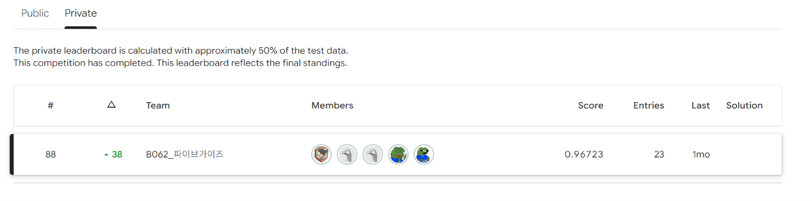

# 텍스트 이미지 VQA — 27~31B VLM LoRA · 확률 앙상블

**SSAFY 16기 2회차 AI 챌린지**(2026.09.21 ~ 09.28, 5인 팀 B062 파이브가이즈, 참가 217팀)


간판·상품·책 사진과 한국어 질문을 보고 보기 4개 중 정답을 고르는 **Visual Question Answering** 과제입니다.
문제의 약 70%가 이미지 속 글자를 읽어야 풀린다는 점에 맞춰 **27~31B급 비전-언어 모델을 최대 896px 입력으로 LoRA 미세조정**했고,
**계열이 다른 세 모델의 a/b/c/d 확률을 가중 평균**해 Private에서 순위를 **38계단** 올렸습니다.

| | Public | Private |
|---|---|---|
| 첫 제출 (로컬 추론) | 0.95204 | — |
| 단일 모델 최고 (Gemma4-31B) | 0.96008 | — |
| **최종 제출** (3모델 확률 앙상블) | **0.96127** | **0.96723** |
| **순위** (217팀 중) | **126위** (상위 58.1%) | **88위** (상위 40.6%, ▲38) |

### 핵심 성과

- **Private에서 38계단 상승 (126위 → 88위)**: 단일 모델의 Public 점수를 쫓는 대신 Qwen3.8 · Gemma4 · Qwen3.5 세 계열의
  a/b/c/d 확률을 0.40 : 0.35 : 0.25로 평균했습니다. 두 대형 모델이 갈린 391문항의 결론을 세 번째 모델이 정했습니다.
- **중단돼도 살아남는 커리큘럼 학습** *(담당)*: 100 update마다 재개 체크포인트를 남기도록 설계해, 마감 때문에 Stage 2의 43%에서
  멈춘 Gemma4-31B를 그대로 썼고 그 모델이 팀 **단일 모델 최고 0.96008**을 냈습니다.
- **검증할 수 있는 앙상블로 전환** *(담당)*: 정답 없이 효과를 확인할 수 없는 LLM 심판 방식을 버리고 확률 앙상블로 바꿨습니다.
  결합 방식 9가지를 비교했고, 스크립트 한 줄로 최종 제출 파일을 **바이트 단위까지 재현**합니다(GPU 불필요).
- **데이터에서 전략을 도출**: OCR 문제 70%와 해상도 병목을 확인해 고해상도 입력과 대형 모델을 택했고, 반복되는 질문 문장과
  dev 라벨 노이즈를 찾아 질문 단위 검증 분할과 3표 합의 pseudo-label을 설계했습니다.

### 팀 구성과 내 역할

| 이름 | 역할 | 담당 |
|---|---|---|
| **김순하** | **팀장 · 모델 학습 · 추가 데이터** | **3-Stage 커리큘럼 QLoRA 설계·학습, 확률 Soft Voting 앙상블, 외부 VQA 데이터 수집·정제(색상·개수·영어), 출처·라벨 방식 검증** |
| 송석현 | 모델 학습 | 베이스 모델 비교, 27B LoRA 학습 설계 |
| 김승훈 | 프롬프트·실험 관리 | OCR 특화 프롬프트, W&B 실험 기록, 앙상블 검토 |
| 김지호 | 데이터 증강·모델 학습 | 촬영 환경 모사 증강 6종, Dev pseudo-label |
| 송현준 | 추가 데이터 확보 | 외부 VQA 데이터 수집·정제, 한·중·일 및 비영어권 데이터 |

기본 train 학습(W&B로 실시간 공유)과 증강·외부 데이터·프롬프트·앙상블 실험을 나눠 병행하는 투트랙으로 진행했습니다. 본문에서 *(담당)* 표시가 붙은 부분이 제가 맡은 작업입니다.

> 📝 [회고](docs/RETROSPECTIVE.md) — 팀 회고 · 개인 회고 (좋은 점 · 아쉬운 점 · 개선점 · 배운 점)
> 📊 [발표 자료](docs/B062_파이브가이즈_솔루션.pdf) — 솔루션 발표 16장 ([PPTX](docs/B062_파이브가이즈_솔루션.pptx)는 발표자 노트 포함) · [중간발표](docs/B062_파이브가이즈_중간발표.pdf)

---

## 목차

1. [문제 정의](#1-문제-정의)
2. [데이터 분석](#2-데이터-분석)
3. [솔루션 구조](#3-솔루션-구조)
4. [핵심 기법](#4-핵심-기법)
5. [결과](#5-결과)
6. [주요 의사결정](#6-주요-의사결정)
7. [실패에서 배운 것](#7-실패에서-배운-것)
8. [회고](#8-회고)
9. [실행 방법](#9-실행-방법)
10. [재현성](#10-재현성)
11. [공개 범위](#11-공개-범위)

---

## 1. 문제 정의

| | |
|---|---|
| 과제 | 이미지 + 한국어 질문 + 보기 4개 → 정답 `a`/`b`/`c`/`d` |
| 평가 지표 | Accuracy (무작위 기준 0.25). Public·Private가 test를 약 절반씩 나눠 채점 |
| 데이터 | train 6,714 (정답 있음) / test 6,714 / dev 2,683 (정답 대신 교육생 응답 5개) |
| 문항 유형 | **OCR·텍스트 약 70%** · 위치·방향 13% · 색상 5% · 수량 1% |
| 입력 이미지 | 간판·상품·책 등 장면 사진 (짧은 변 대개 720px) |
| 규칙 | 데이터 증강은 train과 dev에만 허용 |
| 장비 | Colab G4 RTX PRO 6000 96GB (본 학습) · Colab A100 40GB (초기 비교) · RTX 5060 Ti (베이스라인) |

```
(train_0001)  질문: 사진 속 선반에 적힌 문구는 무엇인가요?
              (a) SUNDAY BURGER LOVE   (b) MONDAY SALAD TIME
              (c) FRIDAY PIZZA PARTY   (d) WEDNESDAY SOUP DAY      →  정답: a
```

---

## 2. 데이터 분석

모델을 고르기 전에 데이터를 먼저 측정했고, 여기서 나온 다섯 가지가 전략을 정했습니다.

**① 약 70%가 글자를 읽어야 풀리는 문제입니다.** 질문 키워드로 분류하면 OCR·텍스트 질문이 train 69.9% / test 69.2%,
위치·방향 13%, 색상 5%, 수량 1%였습니다. "이 가게의 이름은 무엇인가요?" 같은 Scene-Text VQA가 중심이라,
글자 인식과 다국어 이해가 강한 **대형 VLM + OCR 특화 프롬프트**로 방향을 잡았습니다. 외부 데이터도 텍스트 비중을 가장 높게 모았습니다.

**② 병목은 텍스트가 아니라 해상도입니다.** 질문은 평균 31.8자, 보기는 8.9자로 짧은 반면 이미지 짧은 변은 대개 720px입니다.
베이스라인처럼 384px로 줄이면 간판·가격표의 작은 글자가 뭉개지므로 **최대 896px 입력**을 택했습니다.

**③ 같은 질문 문장이 반복됩니다.** "이 가게의 이름은 무엇인가요?"가 62회 나옵니다. 무작위로 나누면 질문 템플릿이 검증셋에 새므로
NFKC 정규화한 **질문 문장 단위로 Group split**(train 6,039 / valid 675, 질문 group 중복 0)했습니다.

**④ dev 응답은 그대로 정답으로 쓸 수 없습니다.** 최다 득표가 3표 이하이고 동률이 465건입니다.
다수결을 정답으로 쓰면 label noise가 들어오므로 **5명 중 3명 이상 같은 답을 고른 2,026문항만** pseudo-label로 썼습니다.

**⑤ train과 test는 분포가 같습니다.** 정답 a~d 비율이 24.5~25.6%로 고르고 문항 유형 비율도 비슷해,
정답 층화 검증 분할로 리더보드 경향을 추정할 수 있다고 판단했습니다.

> 정답 보기가 오답보다 평균 약 1자 깁니다(9.68자 대 8.61자). 이 편향을 모델이 이용하는지는 점검하지 못했습니다([회고](#8-회고)).

---

## 3. 솔루션 구조



- **모델**: 계열이 다른 대형 VLM 세 개. 답을 생성하지 않고 정답 위치의 **a/b/c/d 확률**을 냅니다.
- 확률을 CSV로 저장해 두면 조합을 바꿀 때 GPU를 다시 쓸 필요가 없어, 앙상블 실험을 CPU에서 수 초 만에 반복하고 최종 제출을 그대로 재현할 수 있습니다.

### 최종 앙상블 구성

| 모델 | 학습 방식 | 최대 입력 | 앙상블에 쓴 시점의 학습 상태 | 단일 Public | 가중치 |
|---|---|---|---|---|---|
| Qwen3.8-27B | BF16 LoRA r16 (DeltaNet 포함 496개 모듈) | 896×896 | train 6,714 전체 + 증강 view 80%, 1,510 optimizer step | 0.95829 | 0.40 |
| Gemma4-31B-it | NF4 QLoRA r16 | 672×672 | Stage 1(train) 완료 + Stage 2(증강·dev) 3,485 / 8,104 update | 0.96008 | 0.35 |
| Qwen3.5-27B | NF4, LoRA 거의 미학습 | 672×672 | Stage 3 warmup 2 update(학습률 0 → 3.4e-6)만 반영 → 사실상 zero-shot | 0.94489 | 0.25 |
| **가중 Soft Voting** | | | | **0.96127** | |

- 확률 CSV 파일명에 붙은 `03_final_other`는 노트북의 저장 태그일 뿐입니다. 실제 학습 단계는 위 표와 같으며, 노트북 셀 실행 순서(`execution_count`)와 체크포인트 기록으로 확인했습니다.
- Qwen3.8-27B 단일 점수는 앙상블에 쓴 전체 데이터 재학습 모델의 점수입니다. 검증 분할로 학습한 버전은 0.95918입니다.
- 최종 앙상블의 세 모델 중 외부 데이터(Stage 3)를 실질적으로 학습한 모델은 없습니다.

---

## 4. 핵심 기법

### 4-1. 생성하지 않고 a/b/c/d 확률만 읽기

답을 생성해 파싱하는 대신, **정답이 나올 위치의 logit에서 `a`/`b`/`c`/`d` 토큰 4개만 꺼내 softmax** 합니다.

```
학습:  [system + 이미지 + 질문 + 보기] + "a<|im_end|>\n"   ← 정답 토큰에만 loss (나머지는 -100)
추론:  [system + 이미지 + 질문 + 보기]                     ← 다음 토큰 logit에서 a~d 4개만 비교
```

학습 전 모델에서 greedy 생성 결과와 **64/64 일치**를 확인한 뒤 전환했습니다. 형식 오류가 없고, 문항당 0.29초이며,
확률과 margin이 그대로 앙상블 입력이 됩니다. 학습 전에 prefix 일치와 label masking을 assert로 검증했습니다.

### 4-2. 고해상도 입력과 Gated DeltaNet까지 LoRA (Qwen3.8-27B)

96GB GPU 한 장에서 27B 모델을 **양자화 없이 BF16**으로 학습했습니다.

- **해상도 자동 선택**: 896 → 832 → 768 → 672 → 576px 후보를 최악 조건(가장 긴 질문 + 최대 해상도 이미지)으로 forward/backward 해 보고,
  AdamW 상태까지 더한 예상 peak가 88GB 이하인 최대 해상도를 고릅니다 → **896px (예상 59.1GB)**.
- **LoRA 대상**: attention `q/k/v/o_proj`, MLP `gate/up/down_proj`에 더해 Qwen3.8의 **Gated DeltaNet** `in_proj_qkv/z/a/b`, `out_proj`까지.
  vision tower는 동결 → 496개 모듈, 학습 파라미터 1.17억 개(0.42%).
- **채택 규칙**: 후보가 기준보다 검증 2문항(0.296%p) 이상 좋거나, 정확도가 같고 loss가 낮을 때만 채택합니다. 규칙을 코드로 고정했습니다.

| 하이퍼파라미터 | 최초 27B 시도 | 최종 |
|---|---|---|
| 학습률 | 1e-4 | 2e-5 (linear decay, warmup 3%) |
| LoRA rank / alpha | 8 / 16 | 16 / 32 (dropout 0.05) |
| Effective batch | 2 | 8 (micro batch 1 × accumulation 8) |
| LoRA 대상 | 기본 attention·MLP | + Gated DeltaNet projection |
| 최대 epoch | 5 | 2 (early stopping patience 1) |
| 입력 해상도 | 384×384 | 최대 896×896 |

여러 설정을 한꺼번에 바꿨기 때문에 항목별 기여도는 따로 측정하지 않았습니다.

<details>
<summary>Qwen3.8-27B 노트북 구성 상세 (펼치기)</summary>

| 구성 | 내용 |
|---|---|
| 모델 로드 | `Qwen/Qwen3.8-27B`, BF16, SDPA attention, gradient checkpointing, 단일 GPU 배치 (`device_map={"": 0}`, CPU offload 금지) |
| 프롬프트 | 영어 system prompt(한·영·중·일 OCR과 공간 추론 전문가, 가장 타당한 보기 선택 규칙, 소문자 한 글자 출력) + 한국어 분석 가이드. Qwen3.5 계열은 thinking이 기본으로 켜져 있어 학습·검증·추론 모두 `enable_thinking=False` |
| 검증 분할 | NFKC 정규화한 질문 문장을 group으로 `StratifiedGroupKFold(10)` → train 6,039 / valid 675 |
| 전체 재학습 | LoRA를 떼어내 새로 초기화하고 train 6,714장 전체를 1,510 optimizer step(검증 실험과 같은 학습량) 학습. 7.5시간 시간 보호선, VRAM 90GB 초과 시 즉시 중단 |
| 기타 | weight decay 0.01, grad clip 1.0, fused AdamW, Best Accuracy·Best Loss 체크포인트 별도 저장 |

</details>

### 4-3. 촬영 환경 증강과 Random-View 샘플링

사람이 휴대전화로 간판을 찍을 때 생기는 기울어짐, 흔들림, 저화질, 멀리서 찍힌 작은 글자를 흉내 낸 증강 6종을 원본마다 한 번씩 만들었습니다(중첩 적용 없음).

| 종류 | 설정 (albumentations / EasyOCR) | 원본당 | 생성 수 |
|---|---|---|---|
| 회전 | ±5°, ±10° (`Rotate`, 빈 영역 검은색) | 4 | 26,856 |
| 원근 변환 | `Perspective(scale=0.02~0.05)` | 1 | 6,714 |
| 저해상도 | `Downscale(0.6~0.8)` 후 원래 크기로 복원 | 1 | 6,714 |
| 가우시안 블러 | kernel 3~5, σ 0.1~1.5 | 1 | 6,714 |
| JPEG 압축 | quality 70~90 | 1 | 6,714 |
| 글자 영역 크롭 | EasyOCR(ko, en) 신뢰도 0.3 이상 박스의 합집합 + 여백 30%, 100px 미만 제외 | 0~1 | 5,790 |

- **Random-View**: 매 epoch 원본 1장당 원본 또는 9개 변형 중 하나를 확률 p(70% / 80%)로 고릅니다. epoch 길이가 그대로라 학습 시간이 늘지 않고,
  2 epoch 동안 증강을 한 번 이상 볼 확률은 91% / 96%입니다. `seed + epoch·1,000,003 + index` RNG로 재현되며, 증강은 train 분할에서 파생된 이미지만 쓰도록 assert로 막았습니다.
- **출력**: `train_all_augmented.csv` = 원본 6,714 + 증강 59,502 + dev 합의 라벨 2,026 = 68,242행.

### 4-4. 3-Stage 커리큘럼 QLoRA *(담당)*



LoRA adapter 하나를 **기본 train → 증강 + dev 합의 라벨 → 외부 데이터** 순서로 이어서 학습하는 노트북을 만들고, 모델만 바꿔 네 가지 버전을 실행했습니다.

| Stage | 데이터 | 전체 행 | train / valid | 목적 |
|---|---|---|---|---|
| 1. `01_base_train` | 대회 train | 6,714 | 6,378 / 336 | 과제 형식과 도메인 적응 |
| 2. `02_modify_50000` | 원본 + 증강 9변형 + dev pseudo-label | 68,242 | 64,829 / 3,413 | 촬영 환경 강건성 |
| 3. `03_final_other` | 외부 데이터 5종 ([data/README.md](data/README.md)) | 8,292 | 7,877 / 415 | 다국어 텍스트, 색상·개수 약점 보완 |

- **데이터 통합**: 대회 CSV, 증강 CSV, Excel 메타데이터를 공통 8열(`id,path,question,a,b,c,d,answer`)로 바꾸고, 파일명 인덱스로 옛 경로를 복구합니다.
- **누수 방지**: 증강본을 원본 id(`train_XXXX`, `dev_XXXX`) 기준 `source_group`으로 묶어 같은 이미지의 변형이 train과 valid로 갈라지지 않게 했습니다.
- **잘림 방지**: 긴 샘플에서 정답 토큰이 잘리면 `max_length`를 늘려 다시 인코딩합니다(31B·27B 1024 → 1536, 소형 768 → 1024 → 1536).
- **중단 복구**: 100 update마다 adapter, optimizer, scheduler, RNG 상태, 학습 데이터 fingerprint를 임시 폴더에 쓴 뒤 이름을 바꿔 저장합니다.
  노트북을 위에서부터 다시 실행하면 마지막 완료 지점부터 이어서 학습합니다.
- **기록과 확률 추출**: Stage마다 LoRA 텐서 목록(`parameter_manifest.csv`)과 설정·데이터 fingerprint(`stage_config.json`)를 남기고,
  마지막 셀이 test 6,714문항의 a/b/c/d 확률을 100문항마다 부분 저장하며 계산합니다(31B·27B 약 34분).

| 노트북 | 모델 | 학습률 |
|---|---|---|
| [`gemma4_31b_3stage_g4.ipynb`](notebooks/03_curriculum/gemma4_31b_3stage_g4.ipynb) | `google/gemma-4-31B-it` | 1e-4 |
| [`qwen35_27b_3stage_g4.ipynb`](notebooks/03_curriculum/qwen35_27b_3stage_g4.ipynb) | `Qwen/Qwen3.5-27B` | 1e-4 |
| [`qwen35_4b_3stage.ipynb`](notebooks/03_curriculum/qwen35_4b_3stage.ipynb) | `Qwen/Qwen3.5-4B` | 2e-4 |
| [`gemma4_e2b_3stage.ipynb`](notebooks/03_curriculum/gemma4_e2b_3stage.ipynb) | `google/gemma-4-E2B-it` | 2e-4 |

공통 설정: NF4 double-quant 4-bit QLoRA(BF16 연산), LoRA r16·α32·dropout 0.05, `PagedAdamW8bit`, cosine schedule(warmup 3%), micro batch 1 × accumulation 8, 이미지 256²~672² 픽셀, Stage마다 1 epoch.

### 4-5. 확률 가중 Soft Voting *(담당)*



```
p = 0.40 · p_Qwen3.8-27B + 0.35 · p_Gemma4-31B + 0.25 · p_Qwen3.5-27B   →   argmax
```

1. 확률 CSV마다 행 수(6,714), id 중복, NaN·음수를 검사하고 행별 합이 1이 되도록 다시 정규화합니다.
2. Qwen3.8-27B의 id 순서에 나머지 모델을 맞춥니다.
3. 가중 평균의 최댓값을 답으로 합니다.

세 모델이 모두 같은 답을 낸 문항이 91.78%이고, 나머지 8% 남짓에서 앙상블이 의미를 가집니다. Qwen3.8과 Gemma4-31B는 test 예측이 94.18%만 일치해,
두 모델이 갈린 391문항의 최종 답은 Qwen3.8 쪽 252 · Gemma 쪽 134 · 제3의 보기 5로 정해졌습니다.

| 노트북 | 비교한 방식 | 최종 top3 대비 바뀐 답 |
|---|---|---|
| `ensemble_01_softvote` | top3 가중 평균 **(최종 제출)**, 소형 2종을 더한 5모델 가중 평균 | 5모델: 51문항 |
| `ensemble_02_score_tuned` | 단일 모델 Public 점수로 가중치 조정 (4가지) | 31~72문항 |
| `ensemble_03_top3_methods` | temperature 보정, 다수결 + Gemma 타이브레이크, 상위 2모델 합의 보호, 확신도 게이팅 | 39~60문항 |

변형 9가지는 top3와 0.5~1.1%만 답이 달라 우열을 가릴 근거가 부족했으므로, 리더보드에서 확인된 top3를 유지했습니다.

### 4-6. 약점을 겨냥한 외부 데이터 *(담당: 색상·개수·영어)*

test의 약 70%가 OCR 질문이고 색상 5.4%, 수량 0.8%라는 EDA 결과에 맞춰 텍스트 데이터 비중을 가장 높게 잡아 Stage 3용 외부 데이터 5종(8,292문항)을 모았습니다.

| 데이터 | 출처 | 가공 |
|---|---|---|
| [색상·개수 2,000문항](data/external/count_color_2000.md) | CLEVR (합성) | 색상/개수 × 정답 위치 8개 조합을 250개씩 균형 선별, RGBA → RGB, 동일 픽셀 중복 0 |
| [영어 장면 텍스트 3,000문항](data/external/english_3000.md) | ST-VQA | 26,074문항 후보에서 선별, 원문 정답과 비슷한 형태의 오답을 생성해 4지선다로 변환 (정답 a~d 각 750) |

시드(20260922), 오답 생성 기록, 출처별 주의사항(합성 이미지의 도메인 차이, 자동 OCR 정답, 자동 번역 질문 등)을 [데이터 문서](data/README.md)로 남겼습니다.
다만 대형 모델에서 Stage 3를 실행하지 못해 외부 데이터의 효과는 검증하지 못했습니다.

---

## 5. 결과

### 최종 순위

| | 점수 | 순위 (217팀 중) |
|---|---|---|
| Public | 0.96127 | 126위 (상위 58.1%) |
| **Private (최종)** | **0.96723** | **88위 (상위 40.6%, ▲38)** |




Public과 Private는 test를 약 절반씩(각 약 3,357문항) 나눠 채점합니다. 두 점수의 차이(+0.60%p, 약 20문항)는 차이의 표준오차(약 ±0.45%p)로 보면
우연으로도 설명되는 범위라, 점수가 오른 것 자체보다 **다른 팀들 사이에서 순위가 38계단 오른 것**이 의미 있는 신호입니다.
같은 기준으로 앙상블 이득(+0.00119)은 Public 약 4문항이라, 작은 차이를 문항 수로 환산해 판단했습니다.

### 제출 이력

| # | 구성 | 자체 검증 | Public | 증분 |
|---|---|---|---|---|
| 1 | 첫 로컬 추론 제출 (Day 2) | — | 0.95204 | — |
| 2 | Qwen3.8-27B 개선 설정 + 증강 70% | 95.11% | 0.95918 | +0.71%p |
| 3 | 증강 80% 후보 | 95.41% (+2문항) | 0.95918 | ±0 (노이즈) |
| 4 | 증강 80%, 전체 6,714장 재학습 | — | 0.95829 | −0.09%p |
| 5 | Gemma4-31B 커리큘럼 (Stage 2 43%) *(담당)* | 97.66% (Stage 1) | 0.96008 | +0.09%p |
| 6 | Qwen3.5-27B (사실상 zero-shot) | — | 0.94489 | |
| 7 | Qwen3.5-4B · Gemma4-E2B 3-Stage 완주 *(담당)* | 93.75% · 85.55% (Stage 3) | 0.85224 · 0.64462 | |
| **8** | **4 · 5 · 6번 모델의 확률 가중 평균 (0.40 : 0.35 : 0.25)** *(담당)* | — | **0.96127** | **+0.12%p** |

**최종 선택은 8번 (Private 0.96723).** 증분은 그 시점까지의 최고 Public 점수 대비입니다. 자체 검증은 실험마다 검증셋이 달라 서로 비교할 수 없습니다(2~4번은 질문 단위 675문항, 5·7번은 각 Stage 데이터에서 256문항 생성 평가).

> **끝내지 못한 실험** — Gemma4-31B의 Stage 2(8,104 update)와 대형 모델의 Stage 3(외부 데이터)는 마감 안에 마치지 못했습니다.
> 절반만 학습한 31B가 이미 단일 최고였기 때문에, 이 프로젝트에서 가장 확인해 보고 싶은 방향으로 남았습니다.

---

## 6. 주요 의사결정

| 결정 | 근거 | 결과 |
|---|---|---|
| 27~31B 대형 VLM + 최대 896px 입력 | OCR 문제 70%, 짧은 변 720px. Qwen3.8-27B는 미세조정 전에도 검증 94.37% | 검증 95.41%, Public 0.95918 |
| 27B를 양자화 없이 BF16으로 | 96GB GPU. 메모리 probe로 896px에서 예상 peak 59.1GB 확인 | 해상도를 낮추지 않고 학습 |
| 질문 문장 단위 Group split | 같은 질문이 최대 62회 반복 → 무작위 분할 시 템플릿 누수 | 질문 group 중복 0인 675문항 검증셋 |
| dev는 3표 합의 2,026문항만 사용 | 최다 득표 3표 이하, 동률 465건 | label noise 차단 |
| "+2문항 이상일 때만 채택"을 코드로 고정 | 675문항에서 0.3%p = 2문항 | 감에 의한 선택 배제. 증강 80%는 Public 동일로 확인 |
| 생성 대신 a/b/c/d 확률 | 객관식이라 생성이 필요 없음. greedy와 64/64 일치 | 형식 오류 0, 문항당 0.29초, 앙상블 입력 |
| LLM 심판 대신 확률 앙상블 *(담당)* | 답만 모아 재판정하는 방식은 정답 없이 효과 확인 불가 | Public 0.96127 · Private 0.96723 |
| 중단된 Gemma4-31B 체크포인트를 그대로 사용 *(담당)* | 마감 전에 Stage 2 완주 불가. 재개 체크포인트로 중단 지점 복원 가능 | 단일 모델 최고 0.96008 |
| 변형 9가지 대신 top3 가중 평균 유지 *(담당)* | 변형들은 top3와 0.5~1.1%만 달라 우열 근거 부족 | Private 88위 (▲38) |

---

## 7. 실패에서 배운 것

성공한 것만큼 실패한 것도 많았고, 실패가 다음 판단의 기준이 됐습니다.

| 시도 | 결과 | 판정 |
|---|---|---|
| 27B 첫 학습 (LR 1e-4, batch 2, 최대 5 epoch, 384px) | 검증 손실 0.1102 → 0.1713 → 0.2097 (epoch 2 → 4) | ❌ 과적합 → 설정 재설계 |
| 증강 view 확률 70% → 80% | 검증 +0.30%p(2문항), Public 동일 | ➖ 노이즈 수준 |
| LLM 심판 앙상블 (제출 3개의 불일치 286문항 재판정) | 정답 없이 효과 확인 불가 | ❌ 미채택 |
| 검증셋까지 합친 전체 재학습 | Public −0.00089 (약 3문항) | ❌ 원인 단정 불가 |
| 소형 모델로 3-Stage 완주 | Stage 검증 85~94% → Public 0.64~0.85 | ❌ Stage 검증 ≠ test |
| 앙상블 변형 9가지 | top3와 31~72문항 차이 | ➖ 근거 부족, 미채택 |

### 검증 +2문항은 제출에서 사라졌습니다

증강 80% 후보는 검증에서 95.11% → 95.41%로 올랐지만 Public은 0.95918로 같았습니다. 675문항에서 0.30%p는 2문항이고,
Public 한쪽도 약 3,357문항이라 0.001 차이는 3~4문항입니다. 그런데 두 모델의 test 답은 48문항이나 달랐습니다.
**점수는 같아도 틀리는 문항은 다르다**는 것, 그래서 서로 다른 모델을 합치면 오답을 상쇄할 여지가 있다는 것이 앙상블로 방향을 튼 계기가 됐습니다.

### 절반만 학습한 31B가 끝까지 학습한 4B를 이겼습니다

| 모델 | 학습 상태 | Stage별 자체 검증 | Public |
|---|---|---|---|
| Gemma4-31B | Stage 2의 43% | 97.66% (Stage 1) | **0.96008** |
| Qwen3.5-4B | 3 Stage 완주 | 91.8 / 89.5 / 93.8% | 0.85224 |
| Gemma4-E2B | 3 Stage 완주 | 84.8 / 71.9 / 85.5% | 0.64462 |

소형 모델은 Stage 3 검증에서 85~94%가 나왔지만, 그 값은 외부 데이터 분포에서 잰 것이라 test 성능을 대신하지 못했습니다.
두 가지를 배웠습니다. 이 과제에서는 **모델 용량이 학습 완주보다 중요**했고, 커리큘럼의 모든 Stage는 **대회 데이터로 만든 공통 검증셋**으로 평가해야 Stage 사이의 변화를 비교할 수 있습니다.

---

## 8. 회고

**좋은 점**
- 모델보다 **데이터를 먼저 측정**했습니다. OCR 70%, 해상도 병목, 반복 질문, dev 라벨 노이즈가 이후 모든 결정의 근거가 됐습니다.
- 채택 규칙을 코드로 고정하고, 모든 모델의 확률을 저장해 앙상블을 CPU에서 반복·재현할 수 있게 했습니다.
- *(개인)* 중단을 전제로 설계한 커리큘럼 파이프라인 덕분에 마감으로 멈춘 체크포인트가 팀 단일 최고 모델이 됐습니다.

**아쉬운 점**
- 한 번에 여러 조건을 바꿔 전체 재학습이 떨어진 원인 같은 질문에 답하지 못했습니다. 앙상블 가중치도 Public 점수에 기대어 정했습니다.
- *(개인)* 직접 모은 외부 데이터의 효과를 끝내 확인하지 못했습니다. Stage 2만 8,104 update라는 것을 학습 전에 계산했다면 Stage 2를 줄이거나 Stage 3를 먼저 작게 검증할 수 있었습니다.

**개선점**
1. 대회 초반에 고정 검증셋을 만들고 모든 모델·Stage를 같은 셋으로 평가 — 후보마다 out-of-fold 확률을 남겨 앙상블 가중치도 검증셋에서 고르기.
2. 학습 전에 Stage별 update 수 × update당 시간으로 완주 가능 여부를 계산하고, 외부 데이터는 작은 모델로 "넣었을 때/뺐을 때"를 먼저 비교하기.
3. 한 번에 한 조건만 바꾸고, 실험 기록에 "바꾼 조건"을 필수로 남기기. 선택지 편향은 이미지 없는 text-only 기준선으로 점검하기.

**배운 점**
- 검증 상승과 제출 상승은 다릅니다. 차이를 문항 수로 바꿔 보면 무엇이 노이즈인지 보입니다.
- 앙상블의 힘은 다양성에서 나오고, 정답 없이도 검증할 수 있는 형태여야 합니다.
- *(개인)* 긴 학습은 언제든 끊긴다는 전제로 설계해야 하고, 데이터의 가치는 효과를 측정할 경로가 있어야 생깁니다.

→ 전체 회고: [docs/RETROSPECTIVE.md](docs/RETROSPECTIVE.md)

---

## 9. 실행 방법

### 9-1. 파일 구성

```
.
├── scripts/
│   ├── ensemble_top3.py                   저장된 확률 3개 → 최종 제출 파일 재현 (CPU)
│   └── build_augmentation_manifest.py     증강 CSV → Qwen3.8 노트북용 manifest
│
├── notebooks/
│   ├── 00_baseline/                       SSAFY 제공 baseline v3 (Qwen2.5-VL-3B) 실행본
│   ├── 01_data/all_augmentation.ipynb     증강 6종 + dev pseudo-label
│   ├── 02_qwen38_27b/                     Qwen3.8-27B BF16 LoRA (후보 검증 → 자동 선택 → 전체 재학습 → 추론)
│   ├── 03_curriculum/                     3-Stage QLoRA 4종 (Gemma4-31B, Qwen3.5-27B/4B, Gemma4-E2B)
│   └── 04_ensemble/                       Soft Voting 및 결합 방식 비교
│
├── results/
│   ├── probabilities/                     5개 모델의 test a/b/c/d 확률
│   ├── submissions/submission_final_top3.csv   최종 제출 (Public 0.96127 · Private 0.96723)
│   └── logs/                              학습 기록, 자동 선택 결과, 앙상블 비교 요약
│
├── data/                                  데이터 구조와 외부 데이터 5종 출처·가공 문서
├── docs/
│   ├── RETROSPECTIVE.md                   회고 (팀 · 개인)
│   ├── B062_파이브가이즈_솔루션.pptx / .pdf  솔루션 발표 자료 (16장)
│   ├── B062_파이브가이즈_중간발표.pdf        중간발표 자료
│   └── images/                            리더보드 캡처, 발표 슬라이드
├── requirements.txt
└── .gitignore
```

### 9-2. 환경

| | 실험 환경 |
|---|---|
| GPU | Colab G4 RTX PRO 6000 Blackwell 96GB (본 학습) / Colab A100 40GB (초기 비교) / RTX 5060 Ti (베이스라인) |
| Python / CUDA | 3.13 / 12.8 |
| PyTorch | 2.11.0+cu128 (Colab 기본) |
| transformers / peft / accelerate | 5.17.0 / 0.21.0 / 1.15.0 |
| bitsandbytes / torchao | 0.50.2 / 0.18.0 |
| Gated DeltaNet 커널 | flash-linear-attention 0.5.2 · causal-conv1d 1.7.0 |
| 데이터 · 실험 관리 | albumentations · EasyOCR · scikit-learn · W&B 0.30.0 |

```bash
pip install -r requirements.txt
pip install git+https://github.com/Dao-AILab/causal-conv1d.git --no-build-isolation   # 소스 빌드 필요
```

> - 학습 노트북은 Colab G4 기준이며 첫 셀들이 패키지를 직접 설치합니다. Qwen3.5/3.8과 Gemma 4는 **transformers 5.x**가 필요합니다.
> - Gemma 4는 Hugging Face 모델 페이지에서 라이선스를 승인한 뒤 노트북의 `notebook_login()`으로 로그인합니다.
> - VRAM 최대치: Qwen3.8-27B 후보 학습 88.4GB · 전체 재학습 79.0GB / Gemma4-31B QLoRA 27.1GB / 소형 모델 15~17GB.

### 9-3. 데이터 준비

대회 데이터와 팀 가공 데이터는 포함하지 않습니다. 구조와 준비 방법은 [data/README.md](data/README.md)에 정리했습니다.

```
ssafy-16-2-ai.zip                 대회 원본 (train/test/dev 이미지 + CSV, 암호 압축)
final_data.zip
├── modify_50000/                 Stage 2: train_all_augmented.csv + 원본·증강 이미지 (68,242행)
├── english_3000/  count_color_2000/  chinese_1000/  japanese_1000/  non_english_3000/   Stage 3 외부 데이터
```

압축 비밀번호는 노트북에 적지 않았으므로 Colab에서 먼저 환경 변수로 넣습니다.

```python
import os
os.environ["VQA_ZIP_PASSWORD"] = "<대회에서 제공된 비밀번호>"
```

### 9-4. 실행 순서

```bash
# ⓪ 최종 제출 재현 — 저장된 확률에서 (CPU, 수 초)
pip install pandas numpy
python scripts/ensemble_top3.py
#    → results/submissions/submission_top3_reproduced.csv (6,714행)
#      기존 제출과 다른 답: 0개 (기준: submission_final_top3.csv)

# ① 데이터 증강 — notebooks/01_data/all_augmentation.ipynb (EasyOCR 때문에 GPU 권장)
#    결과를 final_data/modify_50000 에 두고 외부 데이터와 함께 final_data.zip 으로 묶습니다

# ② Qwen3.8-27B (G4, 약 6.7시간)
python scripts/build_augmentation_manifest.py \
    --input  final_data/modify_50000/train_all_augmented.csv \
    --output manifest/train_all_augmented.csv
#    manifest + 증강 이미지 폴더 3개를 vqa_augmented_manifest.zip 으로 묶어 Drive MyDrive/ 에 올리고
#    notebooks/02_qwen38_27b/qwen38_27b_ocr_final.ipynb 를 위에서부터 실행 (W&B 없으면 USE_WANDB = False)
#    출력 test_scores_final_single_model.csv → qwen38_27b_test_probabilities_03_final_other.csv

# ③ Gemma4-31B · Qwen3.5-27B 커리큘럼 (G4)
#    ssafy-16-2-ai.zip, final_data.zip 을 MyDrive/ 에 올리고 RUN_STAGES 로 Stage 를 골라 위에서부터 실행
#    세션이 끊기면 다시 위에서부터 실행 → 마지막 체크포인트에서 이어짐
#    앙상블 당시 상태: Gemma4-31B 는 02_modify_50000/progress/checkpoint-update-00003485,
#                     Qwen3.5-27B 는 학습 셀을 건너뛰고 모델 로드 직후 확률 셀 실행
#    마지막 "앙상블 파일" 셀의 출력에 gemma_31b_ / qwen35_27b_ 접두사를 붙입니다

# ④ 앙상블 — 세 확률 CSV를 results/probabilities/ 에 두고
python scripts/ensemble_top3.py
```

### 9-5. 트러블슈팅

<details>
<summary>대형 모델 학습 파이프라인에서 처리한 문제 7가지 (펼치기)</summary>

| 문제 | 원인 | 해결 |
|---|---|---|
| 마감 전에 학습을 멈춰야 하거나 Colab 세션이 끊김 | 31B·27B는 Stage 2만 8,104 update | 100 update마다 adapter·optimizer·scheduler·RNG·데이터 fingerprint를 임시 폴더에 쓴 뒤 이름 변경으로 저장, 재실행 시 이어서 학습 |
| 해상도를 올리면 OOM 위험 | 이미지 토큰 수가 해상도에 비례 | 최악 조건 probe로 예상 peak 88GB 이하의 최대 해상도 자동 선택, VRAM 90GB 초과 시 즉시 중단 |
| 모델 일부가 조용히 CPU로 내려갈 위험 | `device_map="auto"`의 offload | `device_map={"": 0}` 고정, CPU offload 금지 |
| 정답 한 글자 형식과 thinking 출력이 충돌 | Qwen3.5 계열은 thinking 기본 활성 | 학습·검증·추론 모두 `enable_thinking=False` |
| 긴 샘플에서 정답 토큰이 잘림 | 이미지 토큰 + 긴 질문이 `max_length` 초과 | 정답 토큰이 잘리면 길이를 늘려 다시 인코딩 (1024 → 1536) |
| 외부 데이터·증강 CSV의 이미지 경로가 맞지 않음 | 옛 폴더명 접두사(`count_color_selected_2000/` 등), Windows 역슬래시 경로 | 파일명 인덱스로 경로 복구, manifest 스크립트에서 `/`로 변환 |
| Gated DeltaNet 학습이 느림 | 가속 커널(flash-linear-attention, causal-conv1d)이 없으면 기본 구현으로 동작 | 두 패키지 설치, causal-conv1d는 소스 빌드 |

</details>

---

## 10. 재현성

공개 전에 저장소의 파일만으로 대회 산출물이 재현되는지 확인했습니다.

| 확인 항목 | 결과 |
|---|---|
| `scripts/ensemble_top3.py` ← 저장된 확률 3개 | 실제 제출 파일과 **바이트 단위 일치** (6,714행, 다른 답 0개) |
| `results/probabilities/` 5개 모델 | 모두 6,714행, id 중복 · NaN · 음수 없음 |
| 학습 노트북 출력 | 공개용 정리 후에도 학습·검증 출력 보존 |

- 학습 노트북은 seed 42를 쓰고, 검증 분할과 Random-View 선택, 커리큘럼의 epoch별 샘플 순서가 seed로 결정됩니다.
- **한 가지 차이가 있습니다.** 증강 노트북은 seed를 고정하지 않아, 원근·화질 변환 강도와 EasyOCR 검출 결과가 다시 만들 때 달라질 수 있습니다.
  실제 Qwen3.8 학습에 쓴 증강 manifest는 변형 60,334개였고, 이 저장소의 노트북 출력(글자 크롭 5,790개 기준)은 59,502개입니다.
- LoRA 체크포인트는 용량 때문에 포함하지 않았습니다. GPU 연산의 비결정성과 Colab 패키지 버전 변화 때문에 재학습 결과는 조금 달라질 수 있지만,
  최종 제출은 저장된 확률에서 항상 같은 결과로 재현됩니다.

---

## 11. 공개 범위

- **포함**: 학습·증강·앙상블 노트북(학습 결과 출력 유지), 재현·변환 스크립트, 5개 모델의 test 확률, 최종 제출 파일, 학습 로그, 데이터 구성 문서, 발표 자료, 회고
- **제외**: 대회 데이터(이미지·CSV), 팀 가공 데이터 `final_data`(약 17GB), LoRA 체크포인트(약 27GB, adapter 하나가 수백 MB), SSAFY 배포 가이드 문서
- **정리 내역**: 노트북에서 GitHub 렌더링을 깨뜨리는 위젯 메타데이터, Colab 계정 정보(`executionInfo`), 패키지 설치·로그인 셀의 출력, ANSI 색상 코드를 지웠고,
  대회 데이터 압축 비밀번호는 환경 변수 `VQA_ZIP_PASSWORD`로 바꿨습니다.

<details>
<summary>원본 파일명 대응표 (펼치기)</summary>

| 저장소 경로 | 원본 파일 |
|---|---|
| `notebooks/00_baseline/baseline_qwen25vl_3b_colab.ipynb` | `(260908)_baseline_colab.ipynb` |
| `notebooks/00_baseline/baseline_qwen25vl_3b_local_rotation_aug.ipynb` | `(260827)_baseline_desktop5060ti.ipynb` |
| `notebooks/01_data/all_augmentation.ipynb` | `all_augmentation.ipynb` (`rotate_image`, `quality_image`, `crop_image`, `dev.image` 노트북을 합친 버전) |
| `notebooks/02_qwen38_27b/qwen38_27b_ocr_final.ipynb` | `Qwen38_27B_OCR_Final.ipynb` |
| `notebooks/03_curriculum/gemma4_31b_3stage_g4.ipynb` | `0925_Gemma4_31B_OCR_3Stage_G4_Colab.ipynb` |
| `notebooks/03_curriculum/qwen35_27b_3stage_g4.ipynb` | `0925_Qwen35_27B_OCR_3Stage_G4_Colab.ipynb` |
| `notebooks/03_curriculum/qwen35_4b_3stage.ipynb` | `0924_V2_Qwen35_4B_OCR_Colab.ipynb` |
| `notebooks/03_curriculum/gemma4_e2b_3stage.ipynb` | `0924_V2_Gemma4_E2B_OCR_Colab.ipynb` |
| `notebooks/04_ensemble/ensemble_01_softvote.ipynb` | `ensemble.ipynb` |
| `notebooks/04_ensemble/ensemble_02_score_tuned.ipynb` | `ensemble2.ipynb` |
| `notebooks/04_ensemble/ensemble_03_top3_methods.ipynb` | `ensemble3.ipynb` |

</details>

사용한 모델: [Qwen3.8-27B](https://huggingface.co/Qwen/Qwen3.8-27B) · [Gemma4-31B-it](https://huggingface.co/google/gemma-4-31B-it) · [Qwen3.5-27B](https://huggingface.co/Qwen/Qwen3.5-27B) · [Qwen3.5-4B](https://huggingface.co/Qwen/Qwen3.5-4B) · [Gemma4-E2B-it](https://huggingface.co/google/gemma-4-E2B-it).
외부 데이터 출처: [CLEVR](https://cs.stanford.edu/people/jcjohns/clevr/) · [ST-VQA](https://arxiv.org/abs/1905.13648) · [ICDAR 2017 RCTW-17](https://rctw.vlrlab.net/dataset) · [JaWildText](https://huggingface.co/datasets/llm-jp/jawildtext) · [COCO](https://cocodataset.org/).

대회 데이터와 제공 자료의 저작권은 주최측에, 외부 데이터의 권리는 각 출처에 있습니다.
