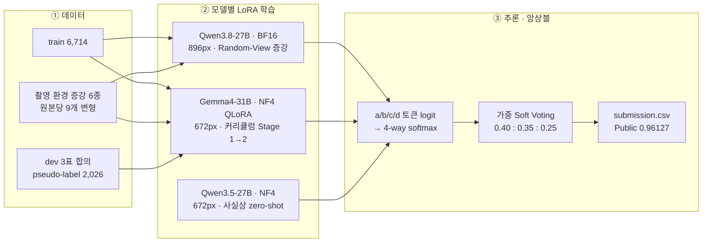

# 이미지로 묻고, AI로 답하다 — 텍스트 이미지 기반 VQA 솔루션

> SSAFY 16기 2회차 AI 챌린지 · 팀 **B062 파이브가이즈** · 최종 **Public LB 0.96127**

이미지 한 장과 한국어 질문, 선택지 4개(a~d)를 받아 정답 한 글자를 고르는 Visual Question Answering 대회의 솔루션이다. 문제의 약 70%가 간판·상품·책에 적힌 글자를 읽어야 풀리는 Scene-Text VQA라는 점에 맞춰, **고해상도 이미지를 받는 27B~31B급 VLM을 LoRA로 미세조정**하고 **세 모델이 낸 a/b/c/d 확률을 가중 평균(Soft Voting)** 해 최종 답을 정했다.

| 항목 | 내용 |
|---|---|
| 최종 점수 | Public LB **0.96127** (단일 모델 최고 0.96008보다 +0.00119) |
| 최종 제출 | Qwen3.8-27B · Gemma4-31B · Qwen3.5-27B의 확률 가중 평균 (0.40 : 0.35 : 0.25) |
| 핵심 기법 | 최대 896px 입력 BF16 LoRA(Gated DeltaNet 포함), 촬영 환경 모사 증강 + Random-View 샘플링, Dev 3표 합의 pseudo-label, a/b/c/d 토큰 확률 추론, 가중 Soft Voting |
| 재현 | `python scripts/ensemble_top3.py` 한 줄로 저장된 확률에서 최종 제출 파일을 바이트 단위까지 똑같이 다시 만든다 (GPU 불필요) |
| 학습 환경 | Google Colab G4 (NVIDIA RTX PRO 6000 Blackwell 96GB) |
| 발표 자료 | [`docs/VQA_Solution_FiveGuys.pptx`](docs/B062_파이브가이즈_솔루션.pptx) (16장, 발표자 노트 포함) · [PDF](docs/B062_파이브가이즈_중간발표.pdf) |

## 목차

1. [대회 개요](#1-대회-개요)
2. [솔루션 한눈에 보기](#2-솔루션-한눈에-보기)
3. [접근 전략](#3-접근-전략)
4. [솔루션 코드 설명](#4-솔루션-코드-설명)
5. [실험 설계와 결과](#5-실험-설계와-결과)
6. [실행 방법](#6-실행-방법)
7. [저장소 구조](#7-저장소-구조)
8. [한계와 향후 과제](#8-한계와-향후-과제)
9. [팀 소개](#9-팀-소개)
10. [참고 자료](#10-참고-자료)

## 1. 대회 개요

- **대회**: [SSAFY 16기 2회차 AI 챌린지 (Kaggle)](https://www.kaggle.com/competitions/ssafy-16-2-ai-9-21-9-28) — 텍스트 이미지 기반 질의응답 모델 개발
- **과제**: 이미지 + 질문 + 선택지 a~d → 정답 한 글자. 평가 지표는 Accuracy (무작위 기준 25%)
- **데이터**: train 6,714문항(정답 있음), test 6,714문항(제출 대상), dev 2,683문항(정답 대신 교육생 응답 5개)
- **규칙**: 데이터 증강은 train과 dev에만 적용할 수 있다. 제출 형식은 `id,answer`

| 예시 (train_0001) | |
|---|---|
| 질문 | 사진 속 선반에 적힌 문구는 무엇인가요? |
| 선택지 | (a) SUNDAY BURGER LOVE (b) MONDAY SALAD TIME (c) FRIDAY PIZZA PARTY (d) WEDNESDAY SOUP DAY |
| 정답 | a |

## 2. 솔루션 한눈에 보기



### 최종 앙상블 구성

| 모델 | 학습 방식 | 최대 입력 | 앙상블에 쓴 시점의 학습 상태 | 단일 Public | 가중치 |
|---|---|---|---|---|---|
| Qwen3.8-27B | BF16 LoRA r16 (DeltaNet 포함 496개 모듈) | 896×896 | train 6,714 전체 + 증강 view 80%, 1,510 optimizer step | 0.95829 | 0.40 |
| Gemma4-31B-it | NF4 QLoRA r16 | 672×672 | Stage 1(train) 완료 + Stage 2(증강·dev) 3,485 / 8,104 update | 0.96008 | 0.35 |
| Qwen3.5-27B | NF4, LoRA 거의 미학습 | 672×672 | Stage 3 warmup 2 update(학습률 0 → 3.4e-6)만 반영 → 사실상 zero-shot | 0.94489 | 0.25 |
| **가중 Soft Voting** | | | | **0.96127** | |

- 확률 CSV 파일명에 붙은 `03_final_other`는 노트북의 저장 태그일 뿐이다. 실제 학습 단계는 위 표와 같으며, 노트북 셀 실행 순서(`execution_count`)와 체크포인트 기록으로 확인했다.
- Qwen3.8-27B 단일 점수는 팀 발표 자료에 기록된 전체 데이터 재학습 모델(앙상블에 쓴 모델)의 점수다. `ensemble_02_score_tuned.ipynb`의 참고 점수표에는 검증 분할로 학습한 버전의 점수(0.95918)가 적혀 있다.
- 최종 앙상블의 세 모델 중 외부 데이터(Stage 3)를 실질적으로 학습한 모델은 없다.

## 3. 접근 전략

### 3.1 EDA가 알려준 방향

| 발견 | 의미 | 결정 |
|---|---|---|
| 질문 키워드 기준 약 70%가 OCR/텍스트 질문 (위치·방향 13%, 색상 5%, 수량 1%) | 글자 인식과 다국어 이해가 병목 | 대형 VLM + OCR 특화 프롬프트 |
| 질문 평균 31.8자, 선택지 평균 8.9자. 원본 이미지 짧은 변은 대개 720px | 텍스트보다 이미지 해상도가 병목. 384px로 줄이면 간판·가격표 글자가 뭉개진다 | 최대 896px 고해상도 입력 |
| 정답 a~d 비율 24.5~25.6%, train과 test 통계가 비슷 | 불균형 처리는 필요 없고 로컬 검증으로 경향을 추정할 수 있다 | 정답 층화 검증 분할 |
| 같은 질문 문장이 여러 이미지에 반복 ("이 가게의 이름은 무엇인가요?" 62회) | 무작위로 나누면 질문 템플릿이 검증셋에 샌다 | 정규화한 질문 문장 단위 Group split |
| dev 최다 득표가 3표 이하이고 동률이 465건 | 다수결을 그대로 정답으로 쓰면 label noise가 들어온다 | 3표 합의 2,026문항만 pseudo-label로 사용 |

정답 선택지는 오답보다 평균 약 1자 길다(9.68자 대 8.61자). 이 편향이 점수에 주는 영향은 따로 점검하지 못했다([한계](#8-한계와-향후-과제) 참고).

### 3.2 전략 원칙

1. **작게 비교하고 크게 확장한다.** 7B·8B 모델과 약 1,700장으로 방향을 정한 뒤 96GB GPU에서 27B로 확장했다.
2. **zero-shot 성능부터 본다.** Qwen3.8-27B는 미세조정 없이도 검증 정확도 94.37%였다. 미세조정은 1%p 안팎을 더하는 단계로 보고 과적합을 가장 경계했다.
3. **검증 상승과 제출 상승을 구분한다.** 675문항 검증셋에서 0.3%p는 2문항이다. 이보다 작은 차이는 우열로 보지 않고, 채택 규칙을 코드로 고정했다.
4. **서로 다른 계열 모델을 섞는다.** Qwen과 Gemma는 test 예측이 94.18%만 일치한다. 틀리는 문항이 다르기 때문에 확률 평균으로 오답을 상쇄할 수 있다.

## 4. 솔루션 코드 설명

### 4.1 데이터 증강과 Dev pseudo-label — [`notebooks/01_data/all_augmentation.ipynb`](notebooks/01_data/all_augmentation.ipynb)

사람이 휴대전화로 간판을 찍을 때 생기는 기울어짐, 흔들림, 저화질, 멀리서 찍힌 작은 글자를 흉내 낸 증강 6종을 원본마다 한 번씩 만든다. 증강을 겹쳐 적용하지는 않는다.

| 종류 | 설정 (albumentations / EasyOCR) | 원본당 | 생성 수 |
|---|---|---|---|
| 회전 | ±5°, ±10° (`Rotate`, 빈 영역 검은색) | 4 | 26,856 |
| 원근 변환 | `Perspective(scale=0.02~0.05)` | 1 | 6,714 |
| 저해상도 | `Downscale(0.6~0.8)` 후 원래 크기로 복원 | 1 | 6,714 |
| 가우시안 블러 | kernel 3~5, σ 0.1~1.5 | 1 | 6,714 |
| JPEG 압축 | quality 70~90 | 1 | 6,714 |
| 글자 영역 크롭 | EasyOCR(ko, en) 신뢰도 0.3 이상 박스의 합집합 + 여백 30%, 100px 미만 제외 | 0~1 | 5,790 |

- **Dev pseudo-label**: `answer1~answer5`의 다수결에서 같은 답이 3표 이상인 2,026문항(전체 2,683문항 중)만 정답으로 쓴다.
- **출력**: `train_all_augmented.csv` = 원본 6,714 + 증강 59,502 + dev 2,026 = 68,242행. 증강 종류별 CSV(`train_plus_rotation.csv` 등)도 함께 만들어 ablation에 쓸 수 있게 했다.
- **Qwen3.8 노트북용 변환**: Qwen3.8 노트북은 원본별로 증강 view를 고르기 위해 `source_id`, `augmentation`, `is_augmented` 열이 필요하다. [`scripts/build_augmentation_manifest.py`](scripts/build_augmentation_manifest.py)가 id 접미사를 해석해 이 열을 추가하고, Windows 역슬래시 경로를 `/`로 바꾼다.

### 4.2 Qwen3.8-27B 단일 모델 — [`notebooks/02_qwen38_27b/qwen38_27b_ocr_final.ipynb`](notebooks/02_qwen38_27b/qwen38_27b_ocr_final.ipynb)

96GB GPU 한 장에서 27B 모델을 양자화 없이(BF16) LoRA로 학습하고, 후보 설정 검증 → 자동 선택 → 전체 데이터 재학습 → 추론까지 한 번에 실행하는 노트북이다.

| 구성 | 내용 |
|---|---|
| 모델 로드 | `Qwen/Qwen3.8-27B`, BF16, SDPA attention, gradient checkpointing, 단일 GPU 배치 (`device_map={"": 0}`, CPU offload 금지) |
| LoRA 대상 | attention `q/k/v/o_proj`, MLP `gate/up/down_proj`, **Gated DeltaNet** `in_proj_qkv/z/a/b`, `out_proj`. vision tower 제외 → 496개 모듈, 학습 파라미터 1.17억 개(0.42%) |
| 해상도 자동 선택 | 896→832→768→672→576px 후보를 최악 조건(가장 긴 질문 + 최대 해상도 노이즈 이미지)으로 forward/backward 해 보고, AdamW 상태까지 더한 예상 peak가 88GB 이하인 최대 해상도를 고른다 → 896px(예상 59.1GB) |
| 프롬프트 | 영어 system prompt(한·영·중·일 OCR과 공간 추론 전문가, 가장 타당한 보기 선택 규칙, 소문자 한 글자 출력) + 한국어 분석 가이드. Qwen3.5 계열은 thinking이 기본으로 켜져 있어 학습·검증·추론 모두 `enable_thinking=False`로 통일 |
| Label masking | system·user·이미지 토큰은 `-100`, 정답 토큰(`a<\|im_end\|>\n`, 3토큰)만 loss 대상. 학습 전에 prefix 일치와 마스킹을 assert로 검증 |
| 검증 분할 | NFKC 정규화한 질문 문장을 group으로 `StratifiedGroupKFold(10)` → train 6,039 / valid 675, 질문 group 중복 0 |
| Random-View 증강 | 매 epoch 원본 1장당 원본 또는 9개 변형 중 하나를 확률 p(70% 또는 80%)로 고른다. `seed + epoch·1,000,003 + index` RNG로 재현 가능하며, epoch 길이가 늘지 않아 학습 시간이 그대로다. 2 epoch 동안 증강을 한 번 이상 볼 확률은 91%(70%)·96%(80%). 증강은 train 분할에서 파생된 이미지만 쓰도록 assert로 막았다 |
| 추론 | 다음 토큰 위치에서 `a/b/c/d` 토큰 logit 4개만 꺼내 softmax → 확률과 margin 저장. 학습 전 모델에서 greedy 생성 결과와 64/64 일치를 확인한 뒤 이 방식으로 전환. 문항당 0.29초 |
| 자동 선택 | 후보(증강 80%)가 기준(70%, 검증 95.11%)보다 2문항(0.296%p) 이상 좋거나, 정확도가 같고 loss가 낮을 때만 채택 → 80% 채택 |
| 전체 재학습 | LoRA를 떼어내 새로 초기화하고 train 6,714장 전체를 1,510 optimizer step(검증 실험과 같은 학습량) 학습. 7.5시간 시간 보호선, VRAM 90GB 초과 시 즉시 중단 |

| 하이퍼파라미터 | 최초 27B 시도 | 최종 |
|---|---|---|
| 학습률 | 1e-4 | 2e-5 (linear decay, warmup 3%) |
| LoRA rank / alpha | 8 / 16 | 16 / 32 (dropout 0.05) |
| Effective batch | 2 | 8 (micro batch 1 × accumulation 8) |
| LoRA 대상 | 기본 attention·MLP | + Gated DeltaNet projection |
| 최대 epoch | 5 | 2 (early stopping patience 1) |
| 입력 해상도 | 384×384 | 최대 896×896 |
| 기타 | | weight decay 0.01, grad clip 1.0, fused AdamW |

최초 시도 설정은 팀 발표 자료 기준이다. 여러 설정을 한꺼번에 바꿨기 때문에 항목별 기여도는 따로 측정하지 않았다.

### 4.3 3-Stage 커리큘럼 QLoRA — [`notebooks/03_curriculum/`](notebooks/03_curriculum)

LoRA adapter 하나를 세 단계 데이터로 이어서 학습하는 노트북이다. 모델만 바꿔 네 가지 버전을 실행했다.

| Stage | 데이터 | 전체 행 | train / valid | 목적 |
|---|---|---|---|---|
| 1. `01_base_train` | 대회 train | 6,714 | 6,378 / 336 | 과제 형식과 도메인 적응 |
| 2. `02_modify_50000` | 원본 + 증강 9변형 + dev pseudo-label | 68,242 | 64,829 / 3,413 | 촬영 환경 강건성 |
| 3. `03_final_other` | 외부 데이터 5종 ([data/README.md](data/README.md)) | 8,292 | 7,877 / 415 | 다국어 텍스트, 색상·개수 약점 보완 |

| 노트북 | 모델 | 학습률 | 비고 |
|---|---|---|---|
| [`gemma4_31b_3stage_g4.ipynb`](notebooks/03_curriculum/gemma4_31b_3stage_g4.ipynb) | `google/gemma-4-31B-it` | 1e-4 | 학습 파라미터 1.22억 개. Gemma 4 입력 형식(`[[image]]`)과 정답 토큰 역방향 탐색 마스킹 |
| [`qwen35_27b_3stage_g4.ipynb`](notebooks/03_curriculum/qwen35_27b_3stage_g4.ipynb) | `Qwen/Qwen3.5-27B` | 1e-4 | DeltaNet projection 포함 496개 모듈 |
| [`qwen35_4b_3stage.ipynb`](notebooks/03_curriculum/qwen35_4b_3stage.ipynb) | `Qwen/Qwen3.5-4B` | 2e-4 | 소형 비교 모델 |
| [`gemma4_e2b_3stage.ipynb`](notebooks/03_curriculum/gemma4_e2b_3stage.ipynb) | `google/gemma-4-E2B-it` | 2e-4 | 소형 비교 모델 |

- **공통 설정**: NF4 double-quant 4-bit QLoRA(BF16 연산), LoRA r16·α32·dropout 0.05(언어 모델 부분만), `PagedAdamW8bit`, cosine schedule(warmup 3%), micro batch 1 × accumulation 8, 이미지 256²~672² 픽셀, Stage마다 1 epoch.
- **데이터 통합**: CSV와 Excel 메타데이터를 공통 8열(`id,path,question,a,b,c,d,answer`)로 바꾸고, 파일명 인덱스로 옛 경로를 복구한다. 증강본은 원본 id(`train_XXXX`, `dev_XXXX`) 기준 `source_group`으로 묶어 같은 이미지의 변형이 train과 valid로 갈라지지 않게 했다.
- **잘림 방지**: 긴 샘플에서 정답 토큰이 잘리면 `max_length`를 늘려 다시 인코딩한다(31B·27B는 1024 → 1536, 소형은 768 → 1024 → 1536).
- **중단 복구**: 100 update마다 adapter, optimizer, scheduler, RNG 상태, 학습 데이터 fingerprint를 임시 폴더에 쓴 뒤 이름을 바꿔 저장한다. 노트북을 위에서부터 다시 실행하면 마지막 완료 지점부터 이어서 학습한다. 소형 모델 노트북은 Stage 2·3에만, G4용 31B·27B 노트북은 모든 Stage에 적용된다.
- **기록(G4용 31B·27B 노트북)**: Stage마다 LoRA 텐서 목록(`parameter_manifest.csv`)과 설정·데이터 fingerprint(`stage_config.json`)를 남기고, 그 Stage의 adapter로 test를 추론해 제출 파일을 따로 저장한다.
- **확률 추출**: 노트북 마지막 "앙상블 파일" 셀이 test 6,714문항의 a/b/c/d 확률(`test_probabilities_*.csv`)을 100문항마다 부분 저장하며 계산한다(31B·27B 기준 약 34분).

### 4.4 앙상블 — [`notebooks/04_ensemble/`](notebooks/04_ensemble), [`scripts/ensemble_top3.py`](scripts/ensemble_top3.py)

1. 확률 CSV마다 행 수(6,714), id 중복, NaN·음수를 검사하고 행별 합이 1이 되도록 다시 정규화한다.
2. Qwen3.8-27B의 id 순서에 나머지 모델을 맞춘다.
3. `p = 0.40·p_Qwen3.8 + 0.35·p_Gemma4-31B + 0.25·p_Qwen3.5-27B`를 계산해 가장 큰 보기를 답으로 한다.

| 노트북 | 비교한 방식 | 최종 top3 대비 바뀐 답 |
|---|---|---|
| `ensemble_01_softvote` | top3 가중 평균 **(최종 제출)**, 소형 2종을 더한 5모델 가중 평균 | 5모델: 51문항 |
| `ensemble_02_score_tuned` | 단일 모델 Public 점수로 가중치 조정 (4가지) | 31~72문항 |
| `ensemble_03_top3_methods` | temperature 보정, 다수결 + Gemma 타이브레이크, 상위 2모델 합의 보호, 확신도 게이팅 | 39~60문항 |

변형 방식들은 top3 가중 평균과 0.5~1.1%만 답이 달라 우열을 가릴 근거가 부족했다. 리더보드에서 확인된 최고 점수는 top3 가중 평균(0.96127)이다.

## 5. 실험 설계와 결과

### 5.1 실험 흐름

| 단계 | 질문 | 설정 | 결과 | 결정 |
|---|---|---|---|---|
| ① 모델 선택 | 어떤 계열이 나은가 | Qwen2.5-VL-7B 대 Qwen3-VL-8B, 약 1,700장(9:1), 2 epoch, 384px, 4-bit QLoRA r8, A100 | 검증 88.39% 대 86.31% | 170문항 중 3~4문항 차이라 우열 보류 |
| ② 프롬프트 | OCR 페르소나·단계 분석이 도움이 되나 | Qwen2.5-VL-7B, 약 1,000장, 프롬프트만 변경 | 84% → 86%, loss 0.1309 → 0.1151 | 두 지표 모두 개선되어 채택 |
| ③ 27B 첫 학습 | 모델을 키우면 좋아지나 | Qwen3.8-27B BF16, 1,700장, 384px, LR 1e-4 | 검증 손실 0.1102 → 0.1713 → 0.2097 (epoch 2→4) | 과적합 신호, 설정 재설계 |
| ④ 27B 개선 | 일반화 우선 설정 | [4.2](#42-qwen38-27b-단일-모델--notebooks02_qwen38_27bqwen38_27b_ocr_finalipynb) 최종 설정, 증강 70% | 검증 95.11%, LB 0.95918 | 기준 모델 |
| ⑤ 증강 비율 | 증강을 더 자주 보면 나은가 | 증강 view 확률만 80%로 | 검증 95.41%(+2문항), LB 0.95918(동일) | 자동 규칙에 따라 80% 채택 |
| ⑥ 전체 재학습 | 검증셋까지 학습하면 나은가 | 6,714장 전체, 1,510 step | LB 0.95829 (−0.00089) | 검증셋 제거·LoRA 재초기화·샘플 순서가 동시에 바뀌어 원인 단정 불가 |
| ⑦ 다른 계열·데이터 | 다양한 모델을 만들 수 있나 | Gemma4-31B, Qwen3.5-27B/4B, Gemma4-E2B 3-Stage | LB 0.96008 / 0.94489 / 0.85224 / 0.64462 | 대형 3종을 앙상블 후보로 |
| ⑧ 앙상블 | 오답이 상쇄되나 | 확률 가중 평균 | **LB 0.96127** | 최종 제출 |

①~③의 수치는 팀 발표 자료에서, ④ 이후는 이 저장소의 노트북 출력과 [`results/logs`](results/logs)에서 가져왔다.

### 5.2 Qwen3.8-27B 검증 기록 (group split 675문항)

| 실험 | 시점 | 검증 정확도 | 검증 손실 | Public LB |
|---|---|---|---|---|
| 미세조정 전 (zero-shot) | — | 94.37% | 0.0713 | — |
| 증강 70% | epoch 1 | 94.81% | 0.0486 | — |
| 증강 70% | epoch 2 | 95.11% | 0.0534 | 0.95918 |
| 증강 80% | epoch 1 | 94.96% | 0.0483 | — |
| 증강 80% | epoch 2 | 95.41% | 0.0541 | 0.95918 |
| 증강 80%, 전체 6,714장 재학습 | 1,510 step | 검증셋 없음 | — | 0.95829 |

epoch 2에서 정확도는 오르고 손실은 올라가는 경향이 두 실험 모두에서 나타나, Best Accuracy와 Best Loss 체크포인트를 따로 저장했다. 80% 후보의 test 예측은 70% 실험의 epoch 2·epoch 1 제출과 각각 48문항(0.71%), 58문항(0.86%)이 달랐다. 점수가 같아도 틀리는 문항은 달랐다는 뜻으로, 여러 모델을 합치면 오답을 상쇄할 여지가 있음을 보여 준다.

### 5.3 3-Stage 커리큘럼 기록 (Stage마다 자체 검증 분할에서 256문항 생성 평가)

| 모델 | Stage 1 | Stage 2 | Stage 3 | Public LB |
|---|---|---|---|---|
| Gemma4-31B | 97.66% | 3,485 / 8,104 update에서 중단 | 미실행 | 0.96008 |
| Qwen3.5-4B | 91.80% | 89.45% | 93.75% | 0.85224 |
| Gemma4-E2B | 84.77% | 71.88% | 85.55% | 0.64462 |

소형 모델은 세 Stage를 모두 마쳤고 Stage 3 검증에서 85~94%가 나왔지만 Public은 0.64~0.85에 그쳤다. Stage별 검증은 그 Stage의 데이터(증강본, 외부 데이터) 분포에서 잰 값이라 test 성능을 대신하지 못한다. 반대로 Stage 2 도중 체크포인트를 쓴 Gemma4-31B가 단일 모델 최고 점수를 냈다.

### 5.4 앙상블 분석 (test 6,714문항)

| 항목 | 값 |
|---|---|
| 세 모델 답이 모두 같음 | 6,162문항 (91.78%) |
| 두 모델만 일치 | 511문항 (7.61%) |
| 세 모델 답이 모두 다름 | 41문항 (0.61%) |
| 모델 쌍별 일치율 | Qwen3.8–Qwen3.5 95.56%, Qwen3.8–Gemma 94.18%, Gemma–Qwen3.5 93.21% |
| Qwen3.8과 Gemma4-31B가 갈린 391문항의 최종 답 | Qwen3.8 쪽 252, Gemma 쪽 134, 제3의 보기 5 |
| 최종 답이 각 단일 모델과 다른 문항 | Qwen3.8 140, Gemma4-31B 258, Qwen3.5-27B 234 |

계열이 다른 두 대형 모델이 391문항(5.8%)에서 갈렸고, 세 번째 모델의 확률이 이 문항들의 결론을 정했다. 추가 학습 없이 확률 평균만으로 단일 모델 최고 0.96008에서 0.96127(+0.119%p)을 얻었다.

### 5.5 시행착오와 교훈

1. **오래 학습할수록 나빠졌다.** 첫 27B 학습에서 epoch가 늘수록 검증 손실이 커졌다. 학습률을 1e-4에서 2e-5로, 최대 epoch를 5에서 2로 줄이고 effective batch를 8로 키웠다.
2. **검증이 오르는 것이 제출이 오르는 것은 아니었다.** 검증 +0.30%p(2문항)가 제출 점수로 이어지지 않았다. 이후 채택 기준(2문항 이상)을 코드로 고정해 감으로 고르지 않게 했다.
3. **답만 합치는 앙상블은 검증할 수 없었다.** 제출 CSV 3개의 불일치 286문항을 Qwen3.8-27B 심판에게 다시 묻는 방식을 만들었지만([`llm_judge_summary_not_adopted.json`](results/logs/ensemble/llm_judge_summary_not_adopted.json)), 정답 없이 효과를 확인할 수 없어 쓰지 않았다. 대신 체크포인트에서 직접 확률을 뽑는 앙상블로 바꿨다.
4. **전체 재학습이 오히려 0.00089 낮았다.** 세 가지 조건이 동시에 바뀌어 원인을 가리지 못했다. 다음에는 한 번에 하나씩 바꾼다.
5. **모델 용량이 결정적이었다.** 같은 커리큘럼을 끝까지 마친 4B·E2B 모델은 Stage 2를 43%까지만 학습한 31B보다 크게 낮았다.
6. **학습은 언제든 멈출 수 있다.** 100 update마다 재개 가능한 체크포인트를 둔 덕분에, 중간에 멈춘 Gemma4-31B의 Stage 2 체크포인트(3,485 update)를 그대로 앙상블에 쓸 수 있었다.

## 6. 실행 방법

### 6.1 최종 제출 재현 (GPU 불필요, 수 초)

저장소에 포함된 세 모델의 확률([`results/probabilities`](results/probabilities))로 최종 제출 파일을 다시 만든다.

```bash
git clone <this-repo-url>
cd ssafy16-2-vqa-solution
pip install pandas numpy
python scripts/ensemble_top3.py
```

```text
저장: .../results/submissions/submission_top3_reproduced.csv (6,714행)
정답 분포: {'a': 1731, 'b': 1691, 'c': 1631, 'd': 1661}
기존 제출과 다른 답: 0개 (기준: submission_final_top3.csv)
```

생성된 파일은 실제 제출 파일 [`submission_final_top3.csv`](results/submissions/submission_final_top3.csv)와 바이트 단위로 같다.

### 6.2 전체 파이프라인 재학습

학습 노트북은 Google Colab G4(96GB) 기준으로 작성되어 있고 Google Drive에 체크포인트를 저장한다. 노트북 첫 셀들이 필요한 패키지를 설치한다([`requirements.txt`](requirements.txt) 참고). 대회 데이터 압축 비밀번호는 노트북에 적지 않았으므로 Colab에서 먼저 환경 변수로 넣는다.

```python
import os
os.environ["VQA_ZIP_PASSWORD"] = "<대회에서 제공된 비밀번호>"
```

**Step 1. 데이터 증강** — `train.csv`, `dev.csv`, `train/`, `dev/`가 있는 폴더에서 [`all_augmentation.ipynb`](notebooks/01_data/all_augmentation.ipynb)를 실행한다(EasyOCR 때문에 GPU 권장). 결과로 `train_all_augmented.csv`와 증강 이미지 폴더 3개가 생긴다. 이것들을 [data/README.md](data/README.md) 구조대로 `final_data/modify_50000`에 두고 외부 데이터와 함께 `final_data.zip`으로 묶는다.

**Step 2. Qwen3.8-27B** (G4, 약 6.7시간)

```bash
python scripts/build_augmentation_manifest.py \
    --input  final_data/modify_50000/train_all_augmented.csv \
    --output manifest/train_all_augmented.csv
```

1. `manifest/train_all_augmented.csv`와 `train_rotate_aug/`, `train_quality_aug/`, `train_text_crop/`을 압축 최상위에 두고 `vqa_augmented_manifest.zip`을 만든다.
2. `ssafy-16-2-ai.zip`과 `vqa_augmented_manifest.zip`을 Drive `MyDrive/`에 올린다.
3. [`qwen38_27b_ocr_final.ipynb`](notebooks/02_qwen38_27b/qwen38_27b_ocr_final.ipynb)를 위에서부터 실행한다. W&B 팀 계정이 없으면 `USE_WANDB = False`로 바꾼다.
4. 출력 `test_scores_final_single_model.csv`의 이름을 `qwen38_27b_test_probabilities_03_final_other.csv`로 바꾼다.

**Step 3. Gemma4-31B · Qwen3.5-27B** (G4)

1. `ssafy-16-2-ai.zip`과 `final_data.zip`을 `MyDrive/`에 올린다. Gemma는 Hugging Face 모델 페이지에서 라이선스를 승인한 뒤 노트북의 `notebook_login()`으로 로그인한다.
2. `RUN_STAGES`로 실행할 Stage를 고르고 위에서부터 실행한다. 세션이 끊기면 다시 위에서부터 실행하면 마지막 체크포인트에서 이어진다.
3. 마지막 "앙상블 파일" 셀들이 `test_probabilities_03_final_other.csv`를 만든다. 각각 `gemma_31b_…`, `qwen35_27b_…` 접두사를 붙인 이름으로 바꾼다.
4. 앙상블 당시 상태를 맞추려면 Gemma4-31B는 `02_modify_50000/progress/checkpoint-update-00003485`에서 확률을 뽑고(`AUTO_RESUME=True`이면 가장 최근 progress 체크포인트를 자동으로 불러온다), Qwen3.5-27B는 학습 셀을 건너뛰고 모델 로드 직후 확률 셀을 실행한다(사실상 zero-shot).

**Step 4. 앙상블** — 세 확률 CSV를 `results/probabilities/`에 두고 `python scripts/ensemble_top3.py`를 실행한다. Colab에서는 `MyDrive/Ensemble/`에 CSV를 두고 [`ensemble_01_softvote.ipynb`](notebooks/04_ensemble/ensemble_01_softvote.ipynb)를 실행해도 된다.

### 6.3 실행 환경과 소요 시간 (실행 로그 기준)

| 작업 | 환경 | 최대 VRAM | 소요 시간 |
|---|---|---|---|
| Qwen3.8-27B 후보 학습 | G4 96GB | 88.4GB | epoch당 약 1시간 27분 (2 epoch) |
| Qwen3.8-27B 전체 재학습 | G4 96GB | 79.0GB | 약 2시간 53분 (1,510 step) |
| Qwen3.8-27B test 추론 | G4 96GB | — | 34분 (문항당 0.29초) |
| Gemma4-31B Stage 1 | G4 96GB | 27.1GB | — |
| 31B·27B 확률 추출 | G4 96GB | — | 33~34분 |
| Qwen3.5-4B · Gemma4-E2B 3-Stage | G4 96GB | 15.3GB · 16.9GB | — |
| 앙상블 | CPU | — | 수 초 |

주요 패키지 버전: torch 2.11.0+cu128, transformers 5.17.0, peft 0.21.0, accelerate 1.15.0, bitsandbytes 0.50.2, flash-linear-attention 0.5.2, causal-conv1d 1.7.0. 초기 모델 비교는 Colab A100 40GB, 베이스라인은 로컬 RTX 5060 Ti에서 실행했다.

### 6.4 재현성

- 학습 노트북은 seed 42를 쓰고, 검증 분할과 Random-View 선택, 커리큘럼의 epoch별 샘플 순서가 seed로 결정된다.
- 증강 노트북은 seed를 고정하지 않았다. 회전 각도는 고정값이지만 원근·화질 변환의 강도와 EasyOCR 검출 결과는 다시 만들 때 달라질 수 있다. 실제로 Qwen3.8 학습에 쓴 증강 manifest는 변형 60,334개였고, 이 저장소의 노트북 출력(글자 크롭 5,790개 기준)은 59,502개다.
- 학습 체크포인트(LoRA adapter)는 용량 때문에 포함하지 않았다. GPU 연산의 비결정성과 Colab 패키지 버전 변화 때문에 재학습 결과는 조금 달라질 수 있다.
- 최종 제출은 저장된 확률에서 항상 같은 결과로 재현된다([6.1](#61-최종-제출-재현-gpu-불필요-수-초)).

## 7. 저장소 구조

```text
ssafy16-2-vqa-solution/
├── README.md
├── requirements.txt
├── docs/
│   ├── VQA_Solution_FiveGuys.pptx          # 솔루션 설명 발표 자료 (발표자 노트 포함)
│   └── VQA_Solution_FiveGuys.pdf           # 같은 자료의 PDF (GitHub에서 바로 보기)
├── notebooks/
│   ├── 00_baseline/                        # SSAFY 제공 baseline v3 (Qwen2.5-VL-3B) 실행본
│   ├── 01_data/all_augmentation.ipynb      # 증강 6종 + Dev pseudo-label
│   ├── 02_qwen38_27b/qwen38_27b_ocr_final.ipynb
│   ├── 03_curriculum/                      # 3-Stage QLoRA (Gemma4-31B, Qwen3.5-27B/4B, Gemma4-E2B)
│   └── 04_ensemble/                        # Soft Voting 및 결합 방식 비교
├── scripts/
│   ├── ensemble_top3.py                    # 최종 제출 재현
│   └── build_augmentation_manifest.py      # 증강 CSV → Qwen3.8 노트북용 manifest
├── data/
│   ├── README.md                           # 데이터 구조와 준비 방법
│   └── external/                           # 외부 데이터 5종 출처·가공 문서
└── results/
    ├── probabilities/                      # 5개 모델의 test a/b/c/d 확률
    ├── submissions/submission_final_top3.csv   # 최종 제출 (Public 0.96127)
    └── logs/                               # 학습 기록, 자동 선택 결과, 앙상블 비교 요약
```

<details>
<summary>원본 파일명 대응표</summary>

| 저장소 경로 | 원본 파일 |
|---|---|
| `notebooks/00_baseline/baseline_qwen25vl_3b_colab.ipynb` | `(260908)_baseline_colab.ipynb` |
| `notebooks/00_baseline/baseline_qwen25vl_3b_local_rotation_aug.ipynb` | `(260827)_baseline_desktop5060ti.ipynb` |
| `notebooks/01_data/all_augmentation.ipynb` | `all_augmentation.ipynb` (`rotate_image`, `quality_image`, `crop_image`, `dev.image` 노트북을 합친 버전) |
| `notebooks/02_qwen38_27b/qwen38_27b_ocr_final.ipynb` | `Qwen38_27B_OCR_Final.ipynb` |
| `notebooks/03_curriculum/gemma4_31b_3stage_g4.ipynb` | `0925_Gemma4_31B_OCR_3Stage_G4_Colab.ipynb` |
| `notebooks/03_curriculum/qwen35_27b_3stage_g4.ipynb` | `0925_Qwen35_27B_OCR_3Stage_G4_Colab.ipynb` |
| `notebooks/03_curriculum/qwen35_4b_3stage.ipynb` | `0924_V2_Qwen35_4B_OCR_Colab.ipynb` |
| `notebooks/03_curriculum/gemma4_e2b_3stage.ipynb` | `0924_V2_Gemma4_E2B_OCR_Colab.ipynb` |
| `notebooks/04_ensemble/ensemble_01_softvote.ipynb` | `ensemble.ipynb` |
| `notebooks/04_ensemble/ensemble_02_score_tuned.ipynb` | `ensemble2.ipynb` |
| `notebooks/04_ensemble/ensemble_03_top3_methods.ipynb` | `ensemble3.ipynb` |

</details>

**공개용 정리 내역**: 노트북 코드와 학습 결과 출력은 그대로 두고, GitHub 렌더링을 깨뜨리는 위젯 메타데이터, Colab 계정 정보(`executionInfo`), 패키지 설치·로그인 셀의 출력, 출력 속 ANSI 색상 코드를 지웠다. 대회 데이터 압축 비밀번호는 환경 변수 `VQA_ZIP_PASSWORD`로 바꿨다.

**포함하지 않은 것**: 대회 원본 데이터, 팀 가공 데이터 `final_data`(약 17GB), LoRA 체크포인트(약 27GB, adapter 하나가 수백 MB라 GitHub 파일 크기 제한 초과), SSAFY 배포 가이드 문서.

## 8. 한계와 향후 과제

- **커리큘럼을 끝까지 돌리지 못했다.** Gemma4-31B는 Stage 2의 43%, Qwen3.5-27B는 사실상 학습 없이 쓰였다. 대형 모델로 세 Stage를 모두 마쳤을 때의 효과는 확인하지 못했다.
- **외부 데이터의 효과를 분리하지 못했다.** Stage 3 데이터가 대형 모델의 test 성능을 올리는지는 아직 모른다. 한 번에 한 조건만 바꾸는 ablation이 필요하다.
- **앙상블 가중치를 정답 있는 검증셋에서 고르지 않았다.** 모든 후보 모델의 out-of-fold 확률을 모아 가중치와 temperature를 검증셋에서 탐색해야 한다.
- **검증셋이 작다.** 675문항에서는 2문항이 0.3%p다. k-fold 교차검증으로 판단의 신뢰도를 높일 수 있다.
- **선택지 편향을 점검하지 않았다.** 정답 선택지가 평균 1자 길다. 이미지 없이 선택지만 보는 text-only 기준선으로 모델이 이 편향에 기대는지 확인할 필요가 있다.
- **추론 시 보강 여지.** 확신도(margin)가 낮은 문항(앙상블 margin 0.2 미만 171문항)에 여러 해상도·글자 영역 크롭 TTA를 적용해 볼 수 있다.

## 9. 팀 소개

**B062 파이브가이즈** — 기본 train 데이터 학습(WandB로 실시간 공유)과, 증강·추가 데이터·프롬프트·앙상블 실험을 나눠 병행하는 투트랙 방식으로 진행했다.

| 이름 | 역할 | 담당 |
|---|---|---|
| 김순하 | 팀장 / 모델 학습·데이터 증강·추가 데이터 확보 | 외부 VQA 데이터 수집·정제, 출처·라벨 방식 검증, 색상·개수·영어 데이터 확보 |
| 송석현 | 모델 학습 | 베이스 모델 비교, 27B LoRA 학습 설계 |
| 김승훈 | 프롬프트·실험 관리 | OCR 특화 프롬프트, WandB 실험 기록, 앙상블 검토 |
| 김지호 | 데이터 증강·모델 학습 | 촬영 환경 모사 증강 6종, Dev pseudo-label |
| 송현준 | 추가 데이터 확보 | 외부 VQA 데이터 수집·정제, 한·중·일 및 비영어권 데이터 확보 |

## 10. 참고 자료

- 모델: [Qwen/Qwen3.8-27B](https://huggingface.co/Qwen/Qwen3.8-27B), [google/gemma-4-31B-it](https://huggingface.co/google/gemma-4-31B-it), [Qwen/Qwen3.5-27B](https://huggingface.co/Qwen/Qwen3.5-27B), [Qwen/Qwen3.5-4B](https://huggingface.co/Qwen/Qwen3.5-4B), [google/gemma-4-E2B-it](https://huggingface.co/google/gemma-4-E2B-it)
- 라이브러리: [Transformers](https://github.com/huggingface/transformers), [PEFT](https://github.com/huggingface/peft), [bitsandbytes](https://github.com/bitsandbytes-foundation/bitsandbytes), [flash-linear-attention](https://github.com/fla-org/flash-linear-attention), [Albumentations](https://github.com/albumentations-team/albumentations), [EasyOCR](https://github.com/JaidedAI/EasyOCR)
- 외부 데이터: [CLEVR](https://cs.stanford.edu/people/jcjohns/clevr/), [ST-VQA](https://arxiv.org/abs/1905.13648), [ICDAR 2017 RCTW-17](https://rctw.vlrlab.net/dataset), [JaWildText](https://huggingface.co/datasets/llm-jp/jawildtext), [COCO](https://cocodataset.org/)
